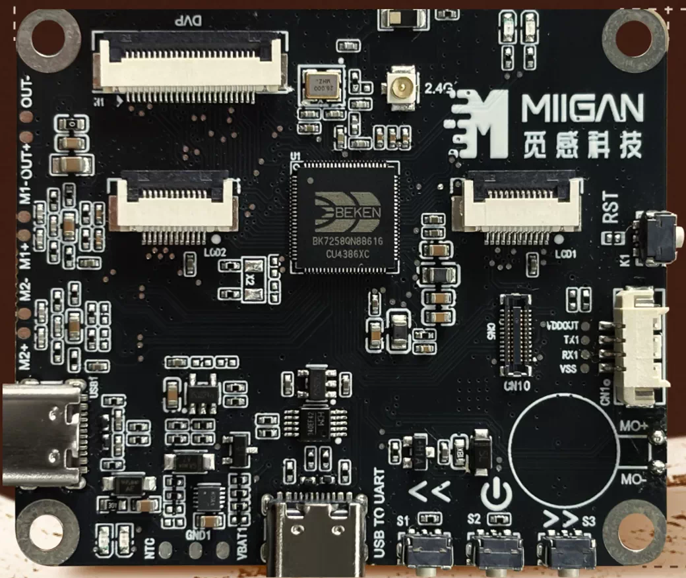
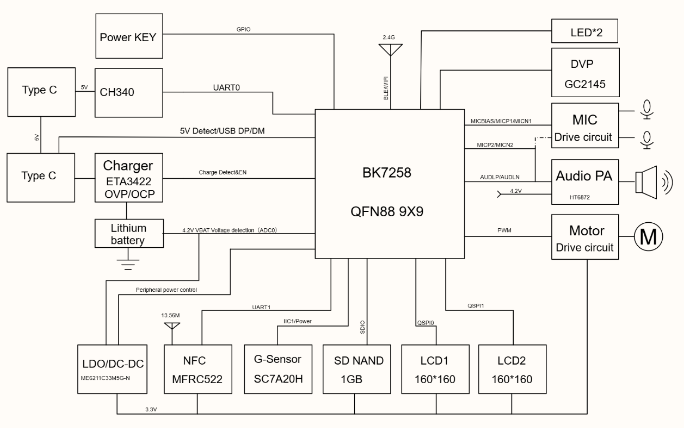
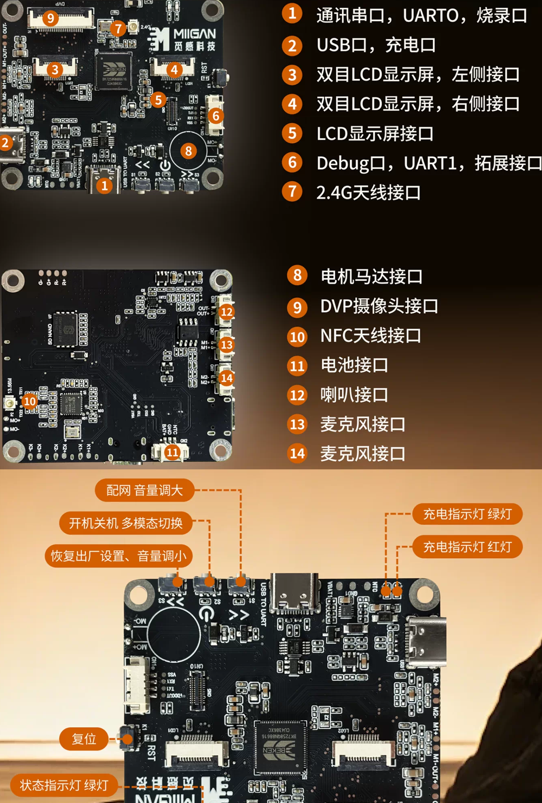

# migan-bk7258

Beken BK7258 R1-style development board.



## Hardware

| Item | Detail |
|------|--------|
| SoC | BK7258 - 3x Cortex-M33, 16 MB PSRAM, 8 MiB SPI NOR flash |
| Console | CH340 USB-UART on **UART0**, 115200 8N1 |
| LED1 | **P40** (GPIO_40), high-active - defaults muxed to LCD, needs `gpio_dev_unmap` |
| LED2 | **P41** (GPIO_41), high-active - same |
| Storage | 60 MB SD NAND (littlefs/FATFS) |



## Projects

| Project | Location | Description |
|---------|----------|-------------|
| `blink_hello` | `boards/migan-bk7258/projects/blink_hello` (this repo) | minimal demo: alternating LEDs + UART0 hello |
| `beken_genie` | `boards/migan-bk7258/projects/beken_genie` (board overlay of the vendor project) | full AI voice solution (Agora, dual-screen, wake word) |

## Build

```bash
make build BOARD=migan-bk7258 PROJECT=blink_hello
make build BOARD=migan-bk7258 PROJECT=beken_genie
```

## Flash (CLI)

```bash
make flash BOARD=migan-bk7258 PROJECT=blink_hello COM=42
```

equivalent to:

```cmd
bk_loader.exe download -p 42 -b 1500000 -i <build>/bk7258/all-app.bin -s 0
```


